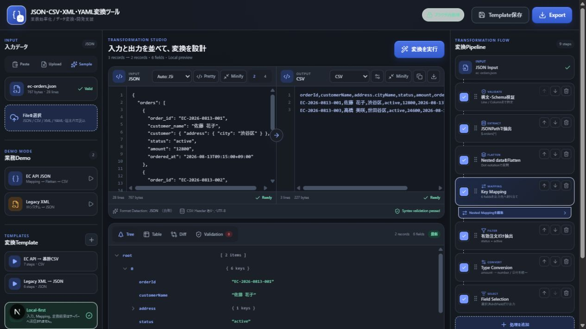
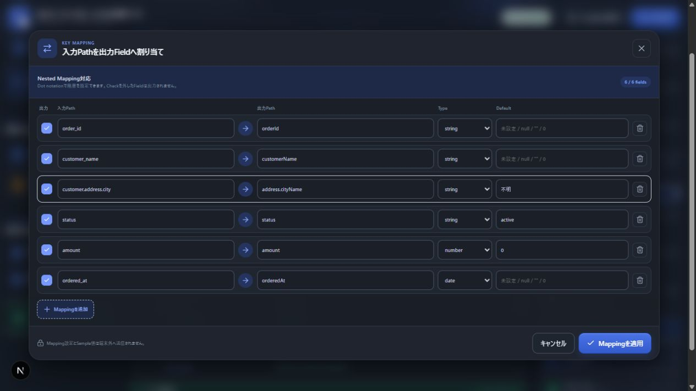

# JSON・CSV・XML・YAML変換ツール

> **Concept Project / 自主制作**
> 実在企業から受託した案件ではなく、架空データを用いて設計・実装したポートフォリオ作品です。

異なるシステム間のデータ連携で発生する、構文確認、項目名の対応付け、型変換、抽出、形式変換、出力を、一つの画面で組み立てるローカルファーストのWeb業務効率化ツールです。

単にJSONを整形するだけではなく、次の業務フローを再利用可能な変換テンプレートとして扱うことを中心にしています。

```text
構造化データを入力
  → Formatを検出・Validation
  → Flatten / Mapping / Filter / Field Selection
  → Type Conversion / Default Value
  → Before / Afterと構造Diffを確認
  → JSON / CSV / XML / YAMLへ変換
  → Copy / Download
  → 設定をTemplateとして次回再利用
```

| 項目 | 内容 |
| --- | --- |
| 作品名 | JSON・CSV・XML・YAML変換ツール |
| カテゴリ | 業務効率化ツール |
| サブカテゴリ | データ変換・開発支援 |
| 主な利用者 | データ移行、システム連携、API確認、運用保守、開発を担当する人 |
| 対応形式 | JSON、CSV、XML、YAML |
| 処理方針 | 入力、変換、Validation、出力をブラウザ内で実行 |
| 保存対象 | ユーザーが保存した変換テンプレート。入力データ本体は保存対象外 |
| 公開URL | なし。local buildのみで、hostingは未設定 |

## Overview

業務システムの移行やAPI連携では、同じ意味の項目でも `customer_name` と `customerName` のようにキー名が異なり、階層、型、必須条件、出力形式も一致しません。本作はCode Editor、Data Tree、Table、Transformation Builderを統合し、データの内容と変換手順を同じ作業面で確認できるようにします。

主な入力方法はPaste、File Upload、Sample Dataです。入力形式は自動判定し、誤判定時はユーザーがJSON / CSV / XML / YAMLを明示的に選び直せる設計です。

## Supported Formats

| Format | Parse / Validation | Serialize / Export | 主な設定 |
| --- | --- | --- | --- |
| JSON | 構文解析、行・列・理由の診断 | Pretty Print、Minify | Indent 2 / 4 |
| CSV | Header、Delimiter、Encodingを考慮 | CSV出力 | Header、カンマ／タブ／セミコロン／パイプ、UTF-8／Shift-JIS |
| XML | XML構文解析、要素・属性・テキストを構造化 | XML出力、Pretty Print、Minify | root名、XML宣言、属性・textノード表現 |
| YAML | YAML構文解析、行・列・理由の診断 | YAML出力 | Indent 2 / 4 |

CSVへ出力する際のNested dataは、Flatten、Dot notation、JSON Stringから扱い方を選びます。XMLはルート要素を保持し、属性を `@name`、要素内テキストを `#text`、同名の繰り返し要素を配列として表します。JSONの配列をXML root直下へ出す場合は、`<item>` の繰り返しにします。定義済みXML entityは安全に往復し、外部entity展開を避けるためDOCTYPEは拒否します。XML固有の表現やYAMLのコメント・アンカー等を完全に保持できない場合があるため、出力前にBefore / AfterとDiffで確認する前提です。

## Transformation Pipeline

変換処理は順序を持つStepとして定義します。各Stepは有効／無効を切り替えられ、同じ設定を別データへ再実行できるシリアライズ可能な構造です。

```text
JSON Input
  ↓ Validation
Flatten: items[] / nested object
  ↓
Key Mapping: customer_name → customerName
  ↓
Filter: status = active AND amount > 10000
  ↓
Type Convert: amount → number, orderedAt → date
  ↓
Field Selection / Default Value
  ↓
CSV Export
```

Transformation Builderでは、次の操作を扱います。

- Flatten：ネストをdot notationまたはunderscore notationへ展開
- Key Mapping：入力pathから出力pathへのキー名・階層変更
- Filter：文字列、数値、存在、空値等をAND / OR条件で絞り込み
- Type Conversion：string、number、boolean、date、nullへ変換
- Field Selection：出力対象のfieldだけを選択
- Default Value：missing、null、空文字等へ既定値を補完
- Extract：対応範囲内のJSONPath / XPathで対象collectionを抽出

JSONPathはproperty、array index、wildcard、quoted propertyに対応し、predicateとrecursive descentは対象外です。XPathは `/`、`//`、`[n]`、`@attribute`、`text()`、`*` のsubsetを扱います。設定Sheetには対応構文を表示し、未対応構文や一致しないqueryはValidationへ渡します。

## Mapping

単純なキー名だけでなく、nested pathを入力元と出力先に指定できる設計です。

```text
customer_name
  → customerName

customer.address.city
  → address.cityName
```

Mapping ruleには必須指定とDefault Valueを設定できます。変換できないpath、必須値の欠落、型変換失敗は、対象pathとStepを追跡できる診断として表示します。

## Validation

構文エラーは、可能な範囲で次の情報をまとめて表示します。

- Line
- Column
- Reason
- 対象Formatとエラー種別

構文が正しいデータに対しては、JSON Schema Draft-07によるValidationとSampleからのSchema候補生成を扱います。生成結果は編集して再検証できます。候補生成は複数Sampleの型を保守的に統合する通常ロジックであり、業務要件を推測するAIではありません。SchemaエラーはJSON pathと理由を示し、構文エラー、Mapping Failure、Type Conversion Failureと区別します。

## Views and Diff

- **Code Editor**：元テキストと変換結果を表示し、Pretty Print / Minifyを切り替える
- **Data Tree**：objectとarrayを階層表示し、Collapse / Expandする
- **Table**：配列系データを行列として確認する
- **Transformation Builder**：処理Stepと設定をGUIで組み立てる
- **Diff**：Added、Removed、Changedをpath単位で区別する

Copyは結果テキストをClipboardへ渡し、Downloadは選択Formatに応じた拡張子とMIME typeでブラウザ内生成します。

## Templates and Demo

変換テンプレートは端末のlocalStorageへ保存します。保存対象は、Mapping、Step順序と有効状態、Filter条件とAND / OR、JSONPath / XPath、出力Format、CSV設定、Indent、Minify、JSON Schemaです。入力データ本体は含めません。変換エンジン側のTemplate形式はversion 1として検証し、未知のversionとoperationを拒否します。

想定する再利用フローは次のとおりです。

```text
新しいDataをPaste / Upload
  → 保存済みTemplateを選択
  → Transform
  → ValidationとDiffを確認
  → Export
```

Demoでは、実在する顧客情報を含まない架空データを使用します。

- EC API JSON → Key Mapping → Flatten → Filter / Type Convert → CSV
- Legacy XML → JSON

## Local-first

- Parse、Validation、Mapping、変換、Diff、Serialize、Downloadをブラウザ内で完結させる
- 入力データや変換結果をアプリ固有のサーバーや外部AI APIへ送信しない
- 入力データ本体をlocalStorageへ保存しない
- localStorageへ保存する内容をユーザーが保存した変換テンプレートに限定する
- 認証、外部Database、APIキーを必須にしない

画面上にもローカル処理であることを明示します。ただし、Webアプリ本体の配信にはホスティング先への通信が必要です。「ファイル処理がブラウザ内で完結する」ことと「Webページが完全オフラインである」ことは区別します。

## Security

- 入力データ、変換結果、ファイル名をアプリ固有のサーバーや外部AI APIへ送信しません。
- 入力データ本体はlocalStorageへ保存せず、保存対象をユーザーが明示保存した変換テンプレートに限定します。
- XMLのDOCTYPEを拒否し、外部entityを展開しません。
- 未知のTemplate version / operationを拒否し、読み込んだ設定をそのまま任意コードとして実行しません。
- CSV出力をSpreadsheetで開く場合、入力値に由来する数式評価リスクは利用側でも確認が必要です。

## Performance

データ処理ロジックはUIから分離した純粋関数を基本としています。入力が200,000 bytesを超えるか、推定5,000 recordsを超える場合はmodule Web Workerへ切り替え、Parse、Transformation、Serializeを別threadで実行します。Worker protocolはDiff、Schema生成・Validation、export ArrayBufferにも対応し、export byte列はtransferして返します。Tableはvisible rowsとoverscanだけを描画し、Code Previewは500,000文字までに制限しますが、Copy / Downloadには完全な変換結果を使用します。

ブラウザQAでは、895,385 bytes・5,200 recordsのJSONをWorker経由で処理し、Filter後の2,600 recordsとvirtualized Tableを確認しました。これは一つのfixtureに対する実測であり、実用上限は列数、nestの深さ、1セルの文字量、Schemaの複雑さ、端末メモリにも左右されます。

## Architecture

```text
Paste / File / Sample
  → Format Detection + Parser
  → Serializable Structured Data Model
  → Validation + JSON Schema
  → Serializable Transformation Pipeline
  → Tree / Table / Diff Preview
  → JSON / CSV / XML / YAML Serializer
  → Clipboard / Browser Download

                           └→ localStorage: Template settings only
```

責務は、FormatごとのI/O、path操作、変換エンジン、Schema、Diff、Template保存、Worker通信、UIへ分離します。ブラウザ／Worker間を通る値はserializableなデータと診断型に限定し、エラーは `source`、`code`、`reason`、`line`、`column`、`path`、`stepId` 等で追跡します。

## 技術構成

- Next.js 16.3 / App Router / static export
- React 19.2 / TypeScript 5.9
- YAML 2.9
- fast-xml-parser 5.10
- Ajv 8
- encoding-japanese 2.2
- Web Worker / Clipboard API / File API / localStorage
- Lucide Reactと専用SVGアイコン
- Vitest 4.1 / Testing Library / jsdom
- ESLint 9

## Setup

必要環境はNode.js 20.9.0以上です。

```powershell
npm.cmd install
npm.cmd run dev
```

PowerShellの実行ポリシーで `npm.ps1` が利用できない環境では、例のように `npm.cmd` を使用してください。環境変数、外部APIキー、Database接続は不要です。

## Test

```powershell
npm.cmd run lint
npm.cmd run typecheck
npm.cmd test
```

2026-08-13時点で、`npm.cmd run verify` が成功しています。内訳はESLint、TypeScript型チェック、Vitest 31件、Next.js static buildです。自動テストは、4形式の検出・Parse・Serialize、Syntax座標、CSV引用符・セル内改行・Shift-JIS、XML entityとDOCTYPE拒否、nested path、Flatten、Mapping、Filter、Type Convert、Default Value、Field Selection、Diff、JSONPath / XPath subset、Draft-07 Schema、version付きTemplate、GUI設定からEngine pipelineへの変換、および組込みEC Demoを使ったWorkbench表示を対象にしています。

in-app browserでは、指定7画面に加え、Legacy XML 2 → 2、Schema生成後のAjv Valid、Template保存・再適用、Copy / Download、390 × 844 mobile、895,385 bytes・5,200 recordsの変換、console warning / error 0件を確認しました。公開URLはなく、Network panel、keyboard / screen reader、複数browser等は追加manual確認です。証跡と確認範囲は [docs/QA_REPORT.md](docs/QA_REPORT.md) を参照してください。

すべての品質ゲートを順に実行する場合は次を使用します。

```powershell
npm.cmd run verify
```

## Build

```powershell
npm.cmd run build
```

`next.config.ts` はstatic exportを使用し、成果物を `out/` へ生成します。`npm.cmd run build:sites` も成功し、Sites向けの `dist/client` と `dist/server` を生成しました。これはlocal deployment artifactの確認であり、実際のhosting設定や公開URLはありません。

## Error Handling

利用者が修正箇所と次の行動を判断できるよう、次のエラーを区別します。

- Invalid JSON / XML / YAML / CSV
- Encoding Error
- Mapping Failure
- Filter Failure
- Type Conversion Failure
- JSON Schema Validation Error
- Template読込Errorと、変換エンジンに渡すTemplateの未知version / operation
- Clipboard / Download等のブラウザ機能Error

入力エラーによって元データを失わないこと、変換失敗時に不完全な結果を正常扱いしないことを基本方針とします。

## Screenshots

2026-08-13に、完成したlocal appを実ブラウザで撮影し、次の7枚を目視確認しました。すべて組込みの架空EC / Legacy dataを使用し、実在する顧客情報を含みません。

1. [`01-input-output-desktop.jpg`](docs/screenshots/01-input-output-desktop.jpg) — JSON Input、CSV Output、Local-first、Flow
2. [`02-tree-view-desktop.jpg`](docs/screenshots/02-tree-view-desktop.jpg) — nested outputのCollapse / Expand
3. [`03-mapping-desktop.jpg`](docs/screenshots/03-mapping-desktop.jpg) — 6 fieldsのKey / Nested Mapping、Type、Default
4. [`04-transformation-flow-desktop.jpg`](docs/screenshots/04-transformation-flow-desktop.jpg) — ExtractからCSV Exportまでの9-step Flow
5. [`05-validation-error-desktop.jpg`](docs/screenshots/05-validation-error-desktop.jpg) — invalid JSONのLine 3 / Column 46 / Reason
6. [`06-diff-desktop.jpg`](docs/screenshots/06-diff-desktop.jpg) — Added / Removed / Changedのpath差分
7. [`07-template-desktop.jpg`](docs/screenshots/07-template-desktop.jpg) — `API A → System B` Template保存dialog





実寸、ファイルサイズ、alt、再撮影条件は [docs/screenshots/README.md](docs/screenshots/README.md) を参照してください。公開版の撮影ではなく、公開URLも設定していません。

## Portfolio

掲載用の基本情報は [docs/PORTFOLIO.md](docs/PORTFOLIO.md)、既存ポートフォリオへ追加する際の確認付きプロンプトは [docs/PORTFOLIO_ADD_PROMPT.md](docs/PORTFOLIO_ADD_PROMPT.md) にまとめています。自動品質ゲート、local desktop evidence、残るmanual確認は [docs/QA_REPORT.md](docs/QA_REPORT.md) に記録しています。

専用アイコンは [`public/icons/data-shift.svg`](public/icons/data-shift.svg) です。`{}` と双方向Transformation Arrowをモチーフにしています。

## Limitations

- Code Editorは行番号、syntax state、Pretty / Minifyを備えた軽量textareaです。CodeMirror / Monacoの補完、token coloring、multi-cursor等は対象外です。
- 異なるFormatの全概念を損失なく往復するものではありません。XMLのmixed content順序、comment、namespace、CDATA表現、YAML comment・anchor・tag等は保持対象外です。
- CSVは表形式のため、複雑なnestをFlattenまたはJSON Stringへ変換する必要があります。
- CSVからParseしたcellは文字列です。数値、boolean、date等が必要なfieldにはType Conversionを設定します。
- Shift-JISに存在しない文字は安全な代替Formatを選ぶ必要があります。
- JSONPathはproperty / index / wildcard / quoted property、XPathは `/` / `//` / `[n]` / attribute / `text()` / `*` のsubsetです。
- SampleからのJSON Schema生成は保守的な候補であり、意味上の必須条件や業務ルールを自動決定しません。
- Templateはブラウザ単位の保存で、クラウド同期、共同編集、アカウント間共有は対象外です。
- 大容量処理の性能は端末とデータ形状に依存します。
- 公開hostingは設定していません。現時点の成果物はlocal build、Sites向け `dist/`、README、テスト、スクリーンショットです。

## License

ポートフォリオ作品として制作しており、リポジトリ全体へ適用するオープンソースライセンスは現時点で設定していません。第三者ライブラリは各パッケージのライセンスに従います。
